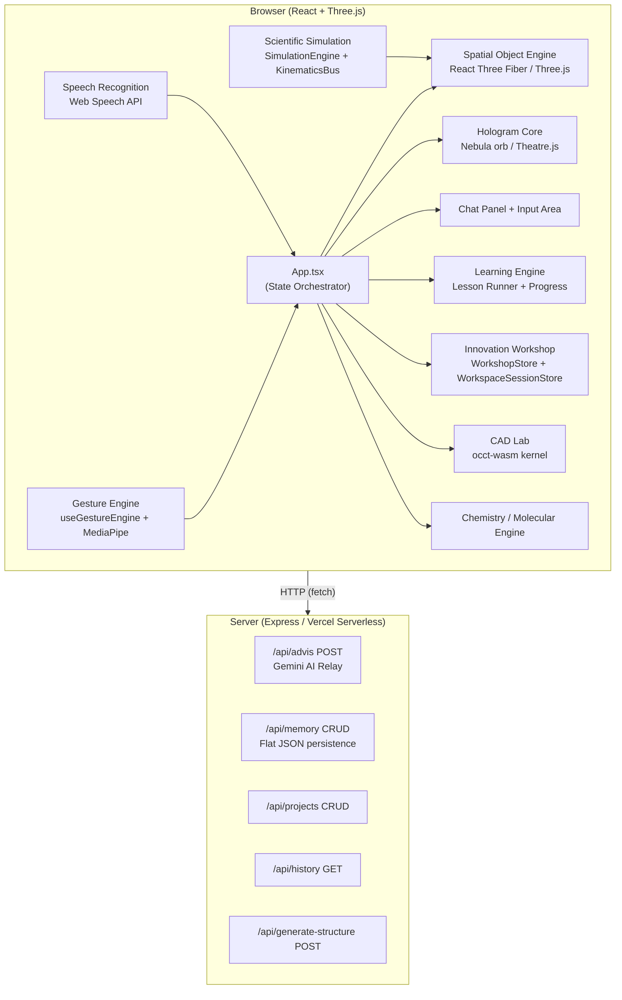
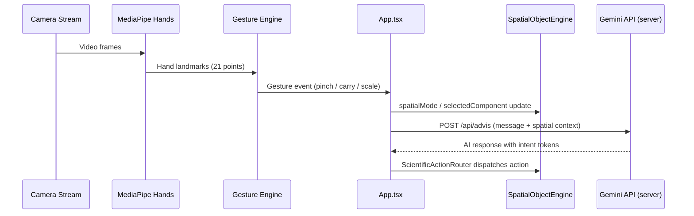

# ADVIS — Architecture

> Last updated: 2026-11-09 | Reflects `main` at commit `87a7198`

---

## System Overview

ADVIS is a **browser-first Spatial AI Operating System**. It runs entirely client-side except for the Gemini AI relay (Express/Vercel). There is no traditional backend database — persistence is `localStorage` on the client and flat JSON files on the server.



---

## Layer Architecture

### 1. Presentation Layer (`src/`)

| Component | Role |
|---|---|
| `App.tsx` | Root state machine — holds all UI state, routes gestures, coordinates mode transitions |
| `HologramCore.tsx` | Animated nebula orb using React Three Fiber; replaces itself with 3D object in Spatial Mode |
| `Background.tsx` | Atmospheric scene background |
| `Sidebar.tsx` | Navigation between ADVIS modes |
| `MobileNav.tsx` | Mobile spatial command pod (shortcut bar) |
| `ChatPanel.tsx` | Multi-turn conversation history |
| `InputArea.tsx` | Text / voice input (triggers `useSpeechRecognition`) |
| `ViewModal.tsx` | Full-screen object inspection modal |
| `UnifiedWorkspaceCenter.tsx` | Command palette + workspace session management |

### 2. Spatial / 3D Rendering Layer

| Component | Role |
|---|---|
| `SpatialObjectEngine.tsx` | Root Three.js scene; routes to per-model controllers |
| `EngineeringReferenceCockpit.tsx` | Engineering workspace with HUD overlays |
| `ScientificHUD.tsx` / `ScientificLaunchpad.tsx` | Scientific mode UI |
| `ScientificComparator.tsx` | Side-by-side model comparison |
| `components/v12/V12EngineController.tsx` | V12 engine Three.js scene + animation |
| `components/v8/V8EngineController.tsx` | V8 engine Three.js scene + animation |
| `AutonomousModelEngine/` | Procedural geometry generation (all built-in models) |
| `generators/` | High-fidelity precision geometry — turbo, gearbox, differential, steering, suspension, PMSM, V8, V12 cutaway |

### 3. Gesture + Interaction Layer

| File | Role |
|---|---|
| `useHandTracking.ts` | Wraps MediaPipe Hands; emits landmark data |
| `MediaPipeAdapter.tsx` | Mounts camera stream and MediaPipe model |
| `GestureContext.tsx` | React context providing gesture state to tree |
| `useGestureEngine.ts` | Processes landmarks → spatial camera orbit, pinch-select, carry-to-rotate, two-hand scale |
| `gestureUtils.ts` | Landmark utility helpers |
| `HolographicCursor.tsx` | Renders cursor at finger tip position |

### 4. AI / Intelligence Layer

| File | Role |
|---|---|
| `server.js` / `api/advis.js` | Gemini API relay; builds system prompt with spatial context |
| `ButlerEngine.js` | Multi-turn conversation manager; passes model/component context into Gemini prompt |
| `scientific/ScientificActionRouter.ts` | Routes AI intent tokens to 3D model operations |
| `scientific/ScientificModelRegistry.ts` | Registry of active scientific models with metadata |
| `AssetIntelligence.ts` | Asset resolution utilities |
| `DigitalTwin.ts` | Digital twin state tracker |

### 5. Scientific Simulation Layer

| File | Role |
|---|---|
| `scientific/SimulationEngine.ts` | Four-stroke engine simulation — deterministic stepping, bounded state |
| `scientific/EngineKinematicsBus.ts` | Pub/sub bus for kinematics data (RPM, crank angle) |
| `scientific/FourStrokeEngineModel.ts` | Analytical model of four-stroke cycle |
| `scientific/HumanAnatomyModel.ts` | Anatomy waveforms (illustrative, not clinical) |
| `scientific/V12ScientificConfig.ts` | V12 camera presets, component hierarchy config |
| `scientific/V12EngineAudioEngine.ts` | Procedural V12 audio driven by RPM |
| `scientific/V8EngineAudioEngine.ts` | Procedural V8 audio driven by RPM |
| `scientific/SynchronizedDiagrams.tsx` | Real-time P-V / stroke diagrams |
| `scientific/V12SynchronizedDiagrams.tsx` | V12-specific diagram sync |
| `scientific/ScientificStore.ts` | Zustand-style scientific state store |
| `scientific/ScientificSchema.ts` | TypeScript schemas for scientific data |
| `scientific/RelationshipGraph.ts` | Component relationship graph |
| `scientific/HierarchicalComponentRenderer.tsx` | Renders component tree with hierarchy |
| `scientific/architecture/ComponentRegistry.ts` | Active component registration/lookup |

### 6. Learning Engine

| File | Role |
|---|---|
| `learning/LessonSchema.ts` | TypeScript schema for authored lessons |
| `learning/LessonCatalog.ts` | Static catalog of STEM lessons |
| `learning/LessonRunner.tsx` | Step-through lesson UI |
| `learning/LessonProgress.ts` | Per-lesson progress persisted to localStorage |
| `learning/LessonPack.ts` | Serialization/export of lesson packs |
| `domains/DomainLearningModules.ts` | STEM domain definitions (electricity, structures, fluids, aerospace, robotics, anatomy) |
| `domains/AnalyticalModels.ts` | Analytical models per domain |
| `LearnEngine/` | Chemistry / molecular learning — MolecularEngine, ValenceValidator, ChemistryDatabase, ChemistryHUD |

### 7. CAD Layer

| File | Role |
|---|---|
| `cad/CadKernelService.ts` | OCCT WASM kernel wrapper (parametric CAD in browser) |
| `cad/CadModelCanvas.tsx` | Three.js canvas for CAD geometry |
| `cad/CADLab.tsx` | CAD lab UI |
| `cad/ParametricInnovationLab.tsx` | Parametric CAD exploration workspace |
| `cad/StudyProject.ts` | CAD study project schema + save/load |
| `cad/GeometryFidelity.ts` | Geometry fidelity validation |
| `cad/CadCertification.ts` | CAD model certification checks |
| `cad/CadAssetRenderer.tsx` | Renders OCCT-generated assets |

### 8. Workshop / Workspace Persistence

| File | Role |
|---|---|
| `workshop/WorkshopStore.ts` | Local innovation workshop state (localStorage) |
| `workshop/WorkshopSchema.ts` | Workshop data schema |
| `workshop/InnovationWorkshop.tsx` | Workshop UI |
| `workspace/WorkspaceSessionStore.ts` | Full spatial session snapshot — all UI state, model selection, kinematics, LOD, chemistry session, lesson runner state |

### 9. Theatre Presentation Layer

| File | Role |
|---|---|
| `theatre/TheatreRuntime.ts` | Theatre.js studio + project initialization (dev only) |
| `theatre/TheatreSceneProvider.tsx` | R3F provider for Theatre |
| `theatre/TheatrePresentationController.ts` | `playMoleculePresentation`, `playV12Presentation`, `stopAllTheatrePresentations` |
| `theatre/TheatreV12Bridge.ts` | Maps Theatre timeline to V12 controller |
| `theatre/TheatreMoleculeBridge.ts` | Maps Theatre timeline to molecular visuals |
| `theatre/TheatreOrbBridge.ts` | Maps Theatre timeline to hologram orb |
| `theatre/TheatreCameraBridge.ts` | Maps Theatre timeline to camera |
| `theatre/TheatreEventBus.ts` | Cross-bridge event bus |
| `theatre/theatreState.ts` | Serialized Theatre project state |

---

## Data Flow: User Gesture → AI Response



---

## State Management

ADVIS uses **React `useState`/`useRef`** at the `App.tsx` level as the primary state store — there is no Redux or Zustand globally. Each subsystem uses local React state or small dedicated stores:

- **Scientific state** — `useScientificStore()` (custom hook in `ScientificStore.ts`)
- **Workspace session** — `WorkspaceSessionStore.ts` (localStorage)
- **Workshop** — `WorkshopStore.ts` (localStorage)
- **Lesson progress** — `LessonProgress.ts` (localStorage)
- **Server persistence** — flat JSON files in `.data/` (`histories.json`, `memories.json`, `advis_memories.json`, `advis_projects.json`)

---

## Deployment Topology

```
GitHub push to main
        │
        ▼
GitHub Actions static.yml
  ┌─────────────────────────────────┐
  │ 1. npm run lint (12 validators)  │
  │ 2. tsc --noEmit                  │
  │ 3. vite build                    │
  │ 4. deploy to gh-pages branch     │
  └─────────────────────────────────┘
        │
        ▼
GitHub Pages → https://ady5545.github.io/ADVIS-NCSC/
                         (base = /ADVIS-NCSC/)

Vercel (optional)
  vercel.json → all routes → server.js
  base = /  (detected via VERCEL env var)
```

---

## Key Dependencies

| Package | Version | Purpose |
|---|---|---|
| `react` | ^19.2.7 | UI framework |
| `@react-three/fiber` | ^9.6.1 | React renderer for Three.js |
| `@react-three/drei` | ^10.7.7 | Three.js helpers (Environment, ContactShadows) |
| `@react-three/postprocessing` | ^3.0.4 | Post-processing effects (Bloom, ChromaticAberration) |
| `three` | ^0.185.1 | 3D rendering engine |
| `framer-motion` | ^12.42.2 | UI animations |
| `@mediapipe/hands` | ^0.4.1675469240 | Hand landmark tracking |
| `@google/genai` | ^2.4.0 | Gemini API SDK |
| `occt-wasm` | ^4.3.2 | OCCT CAD kernel (WebAssembly) |
| `tailwindcss` | ^4.3.3 | Utility CSS |
| `express` | ^5.2.1 | Dev/production HTTP server |
| `vite` | ^6.4.3 | Build tool |
| `typescript` | ^7.0.2 | Type system |

---

## Scientific Honesty Boundaries

> Per the ADVIS scientific trust policy:

- **Four-stroke engine simulation** uses a simplified slider-crank model. Pressure curves are relative teaching indicators, not measured dyno data.
- **V8 / V12 models** do not claim exact OEM specifications. Exact variant details are removed from metadata.
- **Anatomy waveforms** (ECG, etc.) are illustrative and **not** clinical-grade simulations.
- All simulation outputs that are relative/illustrative are labelled as such in the UI.
